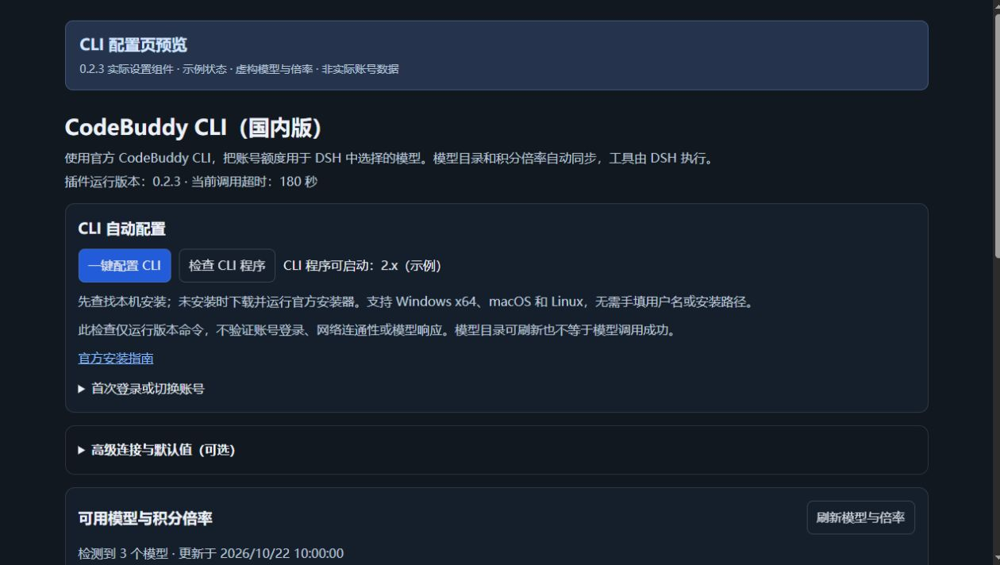
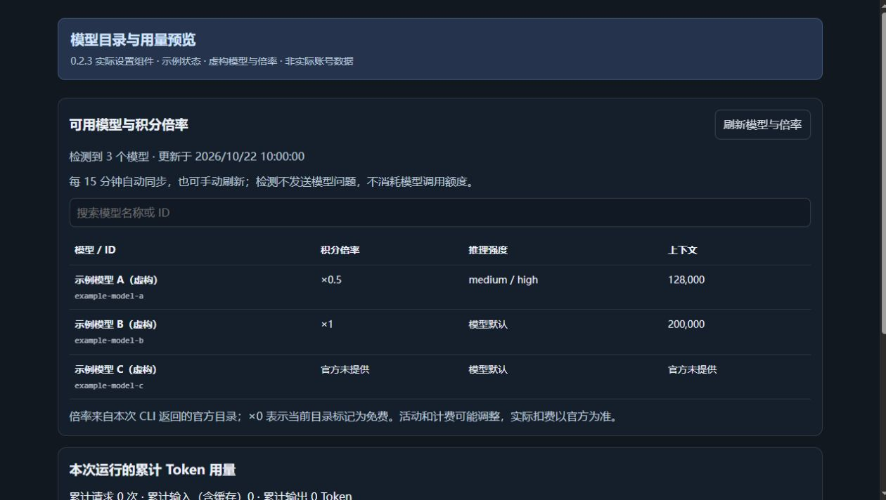
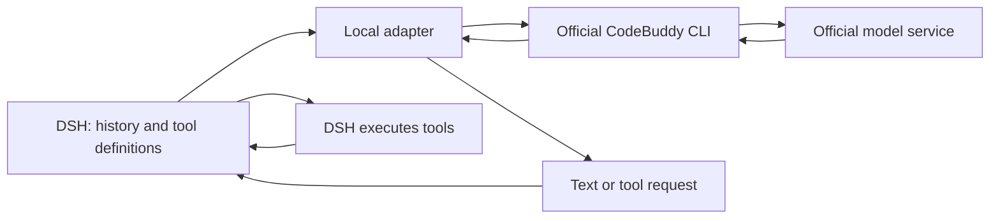

# DSH CodeBuddy CLI (China)

[简体中文](README.md) · **English**

Use models available to your China-region account in **DeepSeek Harness (DSH)** through the official, signed-in CodeBuddy CLI. DSH manages conversations, model selection and tool execution; this plugin translates requests and results.

**Current version: 0.2.6** · China-region CLI · Text input · Tools executed by DSH

[Latest package](releases/dsh-codebuddy-cli-cn-0.2.6.tgz) · [Installation guide](docs/INSTALL.en.md) · [Logs and feedback](docs/TROUBLESHOOTING.en.md) · [Architecture](docs/ARCHITECTURE.en.md)

## 0.2.6 CLI authentication diagnostics

Recognizes 401 notices written to stderr even when stdout is empty and the CLI exits with status zero, instead of reporting invalid JSON. `CLI_AUTH_REQUIRED` now directs users to official `/login`. Logs retain numeric timing, byte counts and exit status without raw error output. Updating the plugin cannot restore account authorization; users must complete official sign-in.

## 0.2.5 diagnostic logs and multi-fragment compatibility

Settings now offer local log viewing, export and clearing. Basic logs exclude request/reply bodies and configuration paths, survive restarts and retain up to 100 calls in a main file capped at 2 MiB. Attach the basic JSON log and reproduction steps to issue reports.

For format errors, explicitly acknowledge the privacy notice and arm capture of the next failed raw model result. Capture turns off after that failure and excludes requests, CLI stderr and login files. Detailed samples may contain chats and code: preview and review before sharing. No logs are uploaded automatically.

Fixes treating every separate bracketed fragment as a protocol result. A single validated result can be recovered only when all remaining fragments are clearly unrelated annotations/examples. Multiple valid results, possible tool requests and malformed or incomplete fragments remain errors. Complete-wrapper compatibility from 0.2.4 is retained, without guessed repairs, retries or tool replays. Earlier unrecorded failures cannot be recovered; the exact reported incident still needs a captured sample to classify.

## Why this exists

The author previously used a WorkBuddy reverse-proxy integration in DSH. After that integration became restricted, the goal was to keep the DSH conversation and tool workflow while routing model calls through the official CodeBuddy CLI.

This is an independent third-party adapter. The local official CLI connects to the official service; the author runs no relay server. Sign-in is handled by the official CLI. Using a documented CLI does not mean this project has official authorization or guarantee that account permissions and service policies will remain unchanged.

## Features

- **Dynamic model discovery:** reads the current China CLI catalog through ACP, without a fixed model allowlist. Refreshes at startup, every 15 minutes and on demand.
- **Credit multipliers:** displays rates, reasoning options and context information returned by the catalog. Missing fields remain unknown.
- **One-click CLI setup:** finds an existing installation or tries the official installer, with a fallback to the official npm package in a user-specific directory.
- **DSH tools:** the model requests tools, DSH executes them under its own permissions, and results become part of the next request.
- **Usage and diagnostics:** separate cumulative and last-call tokens, cache categories, request size, elapsed time and failure details.
- **Portable paths:** uses the current user's directories and system paths instead of the author's username.

A catalog entry is not proof that every account can invoke that model. Permissions, credit allocation and billing are determined by the official service. Remaining credits must be checked on the official website; this plugin has no live balance API.

## Interface previews

These previews render the **actual 0.2.3 settings component** with explicitly labeled example state and fictional models. They illustrate the layout, not a real account or the current official catalog. Screenshots show the Chinese UI; the component also includes English strings. The outer DSH interface varies with its version and theme.





## Quick start

1. Download the `.tgz` above to your computer and install it from DSH's Plugins page. Open `dsh-codebuddy-cli-cn`, then the configuration page for component `llm-codebuddy-cli-cn`.
2. Click **Set up CLI**. Expand the sign-in section, copy its generated command into PowerShell or Terminal, and complete the official China-region sign-in flow.
3. Refresh models and rates, select a discovered model in the DSH conversation model selector, then test a short prompt in a new conversation.

See the [installation and troubleshooting guide](docs/INSTALL.en.md). GitHub's source ZIP is not a DSH plugin package; install the `.tgz`.

## How it works



The adapter sends DSH system instructions, history and tool definitions as text through `--print --output-format json`. It validates the final model result locally and returns text/tool blocks to DSH. CLI tools, MCP and session persistence are disabled. DSH history supplies continuity.

Version 0.2.3 describes the response schema in the prompt instead of using native `--json-schema`. It does not automatically send repair requests. [Architecture details](docs/ARCHITECTURE.en.md).

## Scope and data

- Text input only; image input is not integrated. Responses arrive as complete blocks, without measured token-by-token generation speed.
- Each call sends the current DSH history and tool descriptions to the official service. A CLI call's usage may include multiple internal model requests.
- The plugin passes an optional configuration directory to the CLI; it does not read, copy or package credentials. No account sharing, credit resale or author-operated relay is provided.
- Installation and CLI operation require network access. Catalog discovery sends no model prompt; actual conversations use account credits.
- The default deadline is 180 seconds. Timed-out calls are terminated, without automatic retries. A successful version check only verifies that the executable starts.
- Requires Node.js ≥ 22.19.0 and the DSH dependencies listed in `package.json`. Windows has been tested locally. macOS/Linux installation branches have synthetic test coverage but no complete physical-machine validation.

## Validation and development

27 local tests passed for 0.2.3. Synthetic live scenarios also covered a normal reply, 32 fictional tool definitions, a tool request and continuation with a synthetic tool result. These checks do not establish compatibility with every model, account or environment.

```sh
npm install --legacy-peer-deps
npm test
npm pack
```

Tests use synthetic fixtures and do not invoke real models. DSH supplies host dependencies. `scripts/generate-preview.mjs` renders the documentation previews without sign-in or model calls.

The public repository contains source, synthetic tests, documentation and the latest package. It excludes account research, credentials and real conversation records.

## Official references

- [CLI installation](https://www.codebuddy.cn/docs/cli/installation)
- [Headless mode](https://www.codebuddy.cn/docs/cli/headless)
- [ACP integration](https://www.codebuddy.cn/docs/cli/acp)
- [Cost management](https://www.codebuddy.cn/docs/cli/costs)
- [DeepSeek Harness](https://github.com/deepseek-ai/deepseek-harness)
