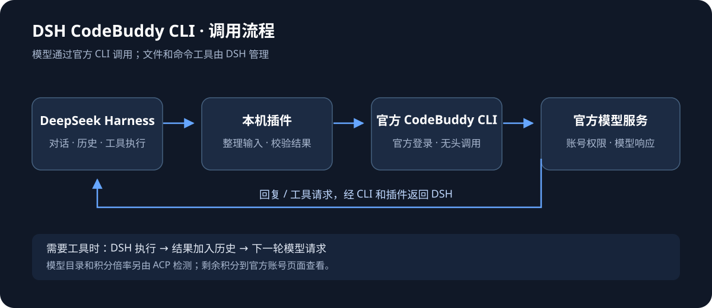

# DSH CodeBuddy CLI（国内版）

**简体中文** · [English](README.en.md)

在 **DeepSeek Harness（DSH）** 中，通过已登录的官方 CodeBuddy CLI 调用国内账号可用的模型。你继续在 DSH 中对话、选择模型和处理工具任务，插件负责转换请求与结果。

**当前版本：0.2.7** · 国内 CLI · 文本输入 · 工具由 DSH 执行

[最新版本安装包](releases/dsh-codebuddy-cli-cn-0.2.7.tgz) · [安装教程](docs/安装教程.md) · [20 步测试手册](docs/测试手册.md) · [测试素材 ZIP](releases/dsh-codebuddy-cli-cn-0.2.7-test-kit.zip) · [日志与反馈](docs/反馈与日志.md) · [工作原理](docs/工作原理.md) · [更新记录](CHANGELOG.md)

## 0.2.7 错误关联与工具结果修复

修复 DSH 将插件错误统一记为 `UNKNOWN` 的问题，保留错误码和诊断 ID；报错中的 `diagnostic-id` 对应导出日志的 `id`。工具失败的 `isError` 标记会传给模型；空白且无工具的回复不再静默结束；CLI 已完成时会释放活动计数，消费端暂停读取不会让它一直显示运行中。

新增中英测试手册、独立测试素材和反馈表。历史失败缺少原始返回的部分仍需采样，不能承诺所有格式错误已消除；401 仍需官方重新登录。本轮只更新国内版。

## 0.2.6 CLI 登录错误识别

修复 CLI 将 401 鉴权错误写入标准错误、标准输出为空且退出码为 0 时，插件误报“没有有效 JSON”的问题。现在显示 `CLI_AUTH_REQUIRED`，提示在官方 CLI 中执行 `/login`；日志保留进程耗时、输出字节数和退出码，不保存原始错误输出。更新插件不会恢复账号授权，仍需用户按官方流程登录。

## 0.2.5 日志入口与多片段误判修复

配置页新增“诊断日志与问题反馈”，可查看、导出和清空本机日志。普通日志不含请求/回复正文或配置路径，重启后保留最近 100 次调用，主文件上限 2 MiB。反馈时可附上普通日志 JSON 和复现步骤。

需要定位原始格式时，手动勾选内容提示并开启“采集下一次失败回复”。只采集下一次失败的原始模型结果，随后自动关闭；不保存请求正文、CLI 标准错误或登录文件。详细样本可能包含聊天和代码，分享前先预览检查。日志不会自动上传。

修复把“多个括号块”一律当成“多个协议结果”的误判：逐块验证后，只有一份有效结果且其余均为明确无关的说明/示例，才允许归一化。多个有效结果、疑似工具请求、损坏或未闭合片段仍失败。保留 0.2.4 的完整包装兼容；不猜测补全，不自动重试或重跑工具。未保存的历史失败原文无法补录，本次真实报错是否属于可恢复类型仍需采样验证。

## 为什么做这个插件

作者此前通过 WorkBuddy 的反代接入方式在 DSH 中使用账号额度。原有接入方式受到限制后，希望保留 DSH 的对话和工具操作体验，于是尝试通过官方 CodeBuddy CLI 完成模型调用。

本项目是独立的第三方适配插件。模型请求由本机官方 CLI 发往官方服务，作者不提供中转服务器；账号登录由官方 CLI 处理。使用官方 CLI 不等于项目获得官方授权，也不保证账号权限或服务策略长期不变。

## 功能

- **同步模型目录**：通过 ACP 获取当前国内 CLI 的模型，没有固定模型白名单。启动时、每 15 分钟及手动刷新时更新。
- **显示积分倍率**：展示目录返回的倍率、推理强度和上下文；缺少的字段显示未知。
- **一键配置 CLI**：自动查找本机安装；缺少时尝试官方安装器，必要时回退到官方 npm 包的当前用户目录安装。
- **使用 DSH 工具**：模型提出工具请求，DSH 按自身权限执行，再携带结果继续下一轮。
- **查看用量与错误**：区分累计与单次 Token、缓存分类、请求文本大小、总耗时和失败原因。
- **适配个人电脑路径**：使用当前用户目录与系统路径，不写死开发者的用户名。

模型目录可见不代表已逐一完成实际调用测试；权限、额度归属和扣费以官方服务为准。剩余积分到官网查看，插件没有实时余额接口。

## 界面预览

以下图片由 **0.2.3 实际设置页组件** 渲染，使用明确标注的示例状态和虚构模型。用于展示布局，不是实际账号数据或当前官方模型清单。DSH 外层界面随版本和主题变化。


## 三步开始

1. 下载上方 `.tgz` 到本机，在 DSH“插件”页安装。打开已安装插件 `dsh-codebuddy-cli-cn`，进入组件 `llm-codebuddy-cli-cn` 的配置页。
2. 点击“一键配置 CLI”。展开“首次登录或切换账号”，复制命令到 PowerShell（macOS/Linux 使用终端），完成官方国内账号登录。
3. 点击“刷新模型与倍率”，在 DSH 会话的模型选择器中选择模型。先用新对话测试一个短问题。

完整步骤、升级与故障排查见 [安装教程](docs/安装教程.md)。GitHub 的源码 ZIP 不是 DSH 插件安装包，请下载 `.tgz`。

## 工作流程



插件整理 DSH 的系统说明、历史和工具定义，通过官方 CLI 的 `--print --output-format json` 调用模型。模型在最终结果中返回文字和工具请求，插件本地检查后交给 DSH。

CLI 自带工具、MCP 和会话持久化关闭；上下文由 DSH 历史承担。0.2.3 不使用 CLI 原生 `--json-schema`，不自动追加修复请求。详见 [工作原理](docs/工作原理.md)。

## 范围与数据

- 当前只传递文本，尚未接入图片输入。完整 JSON 按内容块返回，不提供真实逐 Token 生成速度。
- 每次请求会把当前 DSH 历史和工具说明发送给官方服务；一次 CLI 调用的用量可能包含内部多次模型请求。
- 插件只传递可选登录配置目录路径，不读取、复制或打包凭据。作者不提供账号共享、额度转售或中转服务。
- 自动安装和官方 CLI 运行需要联网。目录检测不发送模型问题；实际对话使用账号额度。
- 默认超时 180 秒，到期结束调用，不自动重试。CLI 版本检查通过只表示程序能启动。
- Node.js 要求 ≥ 22.19.0，DSH 依赖版本见 `package.json`。Windows 已完成本机验证；macOS/Linux 安装分支有合成测试覆盖，尚未完成实体机器端到端验证。

## 0.2.3 更新

取消 CLI 原生 JSON Schema 处理，改为提示词描述协议、本地解析结果，减少额外内部处理。保留结构和工具名称检查，不自动重试或收费修复。

已通过 27 项本地测试，以及普通回复、32 个合成工具、工具请求和合成工具结果后的继续回复验证。详见 [验证与限制](docs/验证与限制.md)。

## 本地开发

```sh
npm install --legacy-peer-deps
npm test
npm pack
```

测试使用合成数据，不调用真实模型。DSH 作为宿主提供运行依赖。截图生成脚本为 `scripts/generate-preview.mjs`，不需要登录或调用模型。

公开仓库包含源码、合成测试、公开文档和最新安装包，不包含账号调研、凭据或真实会话。

## 官方资料

- [CLI 安装指南](https://www.codebuddy.cn/docs/cli/installation)
- [CLI 无头模式](https://www.codebuddy.cn/docs/cli/headless)
- [ACP 集成](https://www.codebuddy.cn/docs/cli/acp)
- [成本管理](https://www.codebuddy.cn/docs/cli/costs)
- [DeepSeek Harness](https://github.com/deepseek-ai/deepseek-harness)
