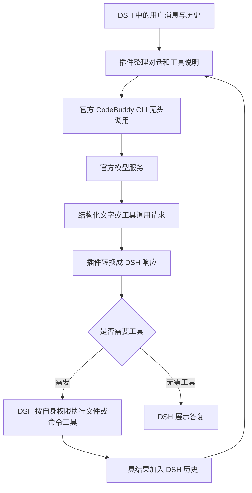

# 工作原理

**简体中文** · [English](ARCHITECTURE.en.md) · [返回首页](../README.md)

这个插件将官方 CodeBuddy CLI 适配成 DSH 的模型提供方。你在 DSH 里选择模型、管理对话和执行工具；插件负责把 DSH 的请求转换成 CLI 能接收的输入，再把 CLI 的结果转换回来。

## 一次请求如何完成

插件向 DSH 注册 `codebuddy-cli-cn` 模型提供方。DSH 发来当前选择的模型 ID、有序对话历史和工具定义后，插件将这些信息整理成文本协议，启动一次官方 CLI 的无头调用。

调用使用 `--print --output-format json`。从 0.2.3 起，不使用 CLI 原生 `--json-schema`，避免其额外的结构化输出处理轮次。所需结构通过提示词中的 responseSchema 描述，模型在最终 result 文本中返回一个包含 `text` 和 `toolCalls` 的 JSON：前者是回复内容，后者是模型希望 DSH 执行的工具名称及参数。插件本地解析、检查结构与工具名称，再转换成 DSH 的文字块、工具调用块和用量信息。结构不正确时报告失败，不自动追加收费修复请求。

从 0.2.1 开始，使用 `--system-prompt` 替换 CLI 默认的 Agent 提示词，减少和本插件用途无关的指令开销。当前工具定义只传递一份。完整 JSON 响应以完整内容块交付，不模拟逐 Token 流式输出，因此不提供可测的模型解码速度。

0.2.4 在检查前识别完整代码围栏、唯一完整 JSON、二次编码与少数明确包装，并只对纯文字或非空工具回复补上可确定的空字段。工具参数字符串必须能完整解码为对象，工具名仍须已声明。未闭合或多个冲突结果不会被猜测补全。诊断只保留固定分类、类型、长度和处理步骤，不记录正文；最近 5 次失败摘要保留到重启。后续成功不会覆盖这份失败历史。

CLI 的内置工具和 MCP 已关闭。模型提出的读取文件、修改文件、运行命令等请求由 DSH 执行，执行结果回到 DSH 对话历史。下一次模型调用再携带更新后的历史，因此可以连续完成多轮任务。

每次请求都会启动一个 CLI 进程，CLI 会话持久化关闭。上下文连续性由 DSH 的历史承担。目前历史通过文本协议传递，插件声明文本输入；图片输入尚未适配。

## 为什么能够使用账号额度

官方 CLI 使用通过其官方流程登录的账号发起模型请求。作者在实际使用中确认，CLI 调用会消耗目标账号额度。插件接入的是该国内账号在官方 CLI 中可使用的服务，具体模型权限、额度归属与扣费由官方判断。

登录由官方 CLI 处理，插件只传递可选的配置目录路径。当前请求的对话内容会发送给官方模型服务，模型调用会消耗账号额度。

## 模型和倍率如何更新

模型检测使用另一条只读流程：插件启动 CLI 的 ACP 模式，发送 `initialize` 和 `session/new`，读取 CLI 返回的模型目录。这个过程不发送模型问题，也不让 CLI 执行工具。

目录中包含模型 ID、显示名称、积分倍率、推理强度和上下文等字段。插件将这些模型注册到 DSH，并在设置页显示目录。启动时、每 15 分钟和手动刷新时会重新检测，没有预先限定某几个厂商或型号。

积分倍率取自该次 CLI 返回的 `credits` 字段。它表示该模型的目录计费信息，不是剩余积分。某模型出现在目录中，也不代表已经对这个账号逐一完成收费调用测试。

## 一键配置如何适配不同电脑

点击“一键配置 CLI”后，插件先查找当前电脑的常见安装位置并检查版本。找到已有安装就保存路径；缺少安装时调用官方安装器，必要时回退到官方 npm 包的用户目录安装。完成后再次检测，设置页保存实际路径。

首次登录仍通过官方 CLI 流程完成。设置页提供可复制的登录命令，登录后刷新模型即可。自动查找使用当前用户目录和系统路径，不写死开发者电脑的用户名。

## 项目范围

这是第三方 DSH 插件，使用官方 CodeBuddy CLI 国内版。当前模型范围以 CLI 公布的目录为准，模型、积分活动和权限可能随官方服务调整。本机 Windows 已完成实际检测；其他系统和全新机器安装的覆盖情况见[验证说明](验证与限制.md)。

## 资料

- [WorkBuddy 定价说明](https://www.codebuddy.cn/docs/workbuddy/Pricing)
- [官方 CLI 无头模式与结构化输出](https://www.codebuddy.cn/docs/cli/headless)
- [官方 ACP 协议集成](https://www.codebuddy.cn/docs/cli/acp)
- [本项目安装与使用说明](../README.md)
